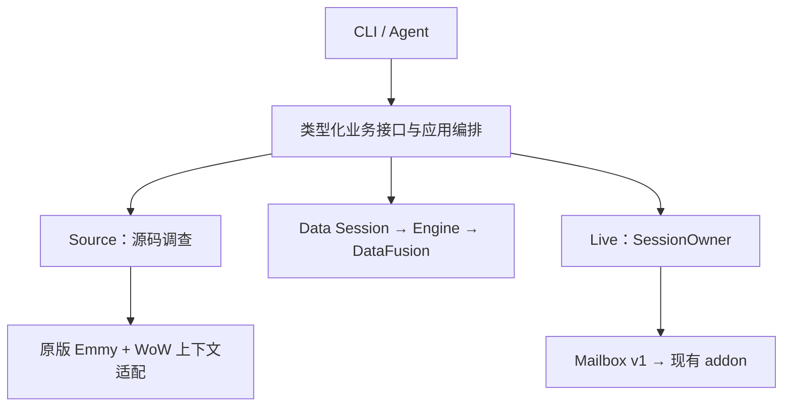
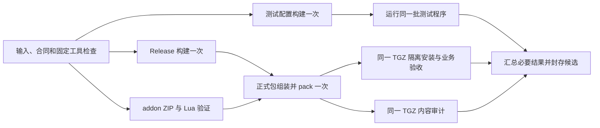

# Lychee Dev 业务架构设计

本文规定当前 Rust 产品的业务目标、调用路径和模块边界，取代早期迁移方案。未完成工作记录在 [todo.md](todo.md)，测试用途与覆盖记录在 [test.md](test.md)，当前实施和实际验证记录在 [handover.md](handover.md)；维护规则见 [AGENTS.md](AGENTS.md)。本文中的要求不代表已经实现或验证。

## 1. 产品目标与范围

Lychee Dev 是供 Agent 和开发者使用的 WoW 调查工具。用户应能从一个业务问题出发，找到源码依据、游戏数据和必要的运行时事实，并保留可复查的结果。

产品由 Rust CLI、现有 Lua addon、第一方 Agent Skill 和 npm 分发包组成。Windows amd64 是交付平台，版本以 [release/version.json](release/version.json) 为准。

本次重构完整承接现有业务及已认可的增强，每种能力只有一条正式执行路径。仓库内不保留 Go 产品实现、LuaLS、旧查询执行器、旧协议原型及其兼容入口，也不为测试保留这些实现。

**addon 沿用 [addon/](addon/) 中的现有实现。** 保留其现有工具、界面、功能开关、客户端适配、中英文 locale 和 Mailbox v1。Rust Live 接入现有 addon；本方案不要求重写 addon、替换传输协议或重做游戏内产品。后续真实缺陷按具体问题修复。

### 客户端产品身份

当前支持范围为 Retail、Classic、Classic Era、Titan、正式 Forever 和 Anniversary 六个产品。Forever 的规范产品 ID 与 Source family 均为 `forever`，官方远端产品与安装 flavor 均为 `wowf`，实际客户端目录为 `_forever_`，可执行文件为 `Wow.exe`。`wow_forever` 不得作为远端产品码；`forever-asia-beta` / `wow_classic_beta` 和 `forever-cn-beta` / `wow_cn_beta` 不再作为当前支持目标。

这一范围贯穿 CLI 发现和选择、Source/Data/Changes、安装识别、Delivery、addon Compat/ClientGate、Live 绑定及恢复。目录只是线索；安装识别交叉核对 `.flavor.info`、存在时的 `version.txt` 和共享根 `.build.info`，按产品选择可执行文件；Live 再核指定进程和新鲜 INPUT 中的实际产品/build。正式 Forever 不回退到 Beta 目录、数据 slot、远端端点或缓存身份。版本系列、TOC Interface 与完整 build 分别保留，不从远端最新 build 推导最低支持边界。

历史 PIN、CAP、原始输入和未完成恢复保留原产品、build/config 及父身份。历史记录可读与当前目标可选分别判断；旧 `forever` DataPin 也不能仅凭名称被认作来自 `wowf`，不能静默重标、重新选择或覆盖原身份。正式产品的实现与离线验证属于本轮；真实客户端测试仍由用户后续安排。

## 2. 先定义完整业务

接口围绕用户要得到的结果设计。常用任务有直接的领域接口，复杂调查有通用查询和组合能力。

| 用户任务 | 应交付的结果 |
| --- | --- |
| 调查 API、Lua 符号或 UI 行为 | 声明、引用、调用、加载关系、位置和诊断，以及所选源码与客户端范围。 |
| 调查法术 | 名称、效果、光环、召唤及相关记录，完整关系和缺失原因。 |
| 调查物品、外观或生物资源 | 模型、材质、geoset、显示记录、资源身份及选择依据。 |
| 调查副本遭遇和装饰物 | 对应树、列表、详情、顺序及关联记录。 |
| 自定义数据调查 | 字段与语义发现、精确查找、筛选、关联、聚合、子查询和受限递归。 |
| 查看或导出调查结果 | 对同一结果分页、导出 JSON/CSV、保存完整证据，保留精确数值与覆盖状态。 |
| 核实游戏运行行为 | 在指定实例完成现有 addon 支持的检查，取得报告并处理连接和清理。 |
| 联合源码、数据与运行时调查 | 明确关联的身份和来源，分别说明静态推断、数据事实和实际观察。 |
| 作者发布与云备份 | 在明确的平台、账号、资源和动作上完成发现、字段/文件准备、提交、独立读回与必要恢复，保留省略/清空、关联保护和不确定提交状态。 |

每个任务都必须能通过正式入口完成。缺失能力进入待办，不能通过缩小结果、固定返回 unsupported 或保留旧入口来宣布完成。

## 3. 调用结构与类型化边界

### 入口与应用编排

[commands.json](crates/lycheedev-cli/src/commands.json) 是唯一命令目录。命令导航和参数合同来自该目录，领域请求与结果 schema 来自当前类型化接口；解析、help、describe、search、schema 和示例保持一致，不各自维护一份能力清单。

CLI 负责解析参数和输出；Agent 协议入口负责解码请求。入口将输入转换为明确的业务类型，例如 SourceRequest、DataRequest、LiveRequest。业务模块不接收 CLI flags 字典，不解析命令字符串，也不依赖终端或 JSONL 输出方式。

参数合法性在入口验证；业务模块负责自己的业务约束；文件、网络、进程和游戏协议在相应外部边界验证。已经成立的内部合同直接使用，不在每层重复校验同一事实。

应用层组合领域能力并保留它们的来源。应用编排是职责，不要求新增常驻服务或通用工作流框架。Source、Data 不互相依赖，也不依赖 Live；Live 通过 Delivery 完成受管安装操作。

### Skill：精简的 Agent 使用入口

Skill 必须特别精简。正文只保留短用途说明、Source/Data/Live 的选择、紧凑的产品/版本速查表、CLI 发现入口和少量必要约束。参数、类型、默认值、完整命令列表及完整操作步骤由 CLI 自解释；确有必要的专项 references 按任务读取，默认不加载整套资料。

产品/版本速查必须保留用户常用说法与规范产品身份的映射，例如 `forever／无限服`，以及对应版本系列和已知 build ID 范围。它们是理解用户意图需要的当前产品词汇，不属于旧架构兼容资料。速查与 CLI 产品目录使用同一来源更新，不把版本系列、build ID 和 TOC Interface 混为一谈，不猜测范围边界。

`forever／无限服` 指向正式产品 `forever`。区域、build、locale、Source 与 Data 固定身份仍分别选择；相同常用简称不授权修改项目中的旧 PIN 或恢复记录。

Skill 及其 references、CLI 帮助、能力描述、示例和普通错误构成面向 Agent 的产品使用面。这些内容不得混入历史 Go 版本、迁移阶段、旧入口对照、oracle、开发分支、内部构建身份、审计轮次或性能验收记录，也不引导 Agent 阅读仓库交接和研发文档。Agent 无需了解产品的重构过程即可完成任务。

当前 CLI/协议版本、目标客户端产品/build、源码身份、实际能力限制和结果来源属于必要使用事实，继续准确提供。精简不能删掉 partial 的含义、结果句柄与 CAP 的区别或未知输入不重放等实际操作约束。

Skill 不复制 CLI 已执行的准备、传输和恢复逻辑，不另写替代执行器。精简效果以 Agent 能否正确选用能力并完成任务衡量，不以行数或文件数量衡量。

### CLI：面向 Agent 的自解释能力

Agent 仅凭安装后的 Skill 与 CLI，就应能找到能力、构造合法请求、理解结果并纠正调用错误。自解释是正式产品能力，覆盖命令行与 Data Agent 协议，不能只提供面向人的帮助文本或命令名称列表。

| Agent 需要知道什么 | CLI 必须提供什么 |
| --- | --- |
| 哪项能力能解决当前任务 | 按业务任务检索的少量相关能力、用途和适用范围；识别维护的常用产品叫法并返回规范身份与版本/build 约束，使用当前命令目录，不列历史或未实现入口。 |
| 应该如何调用 | 精确命令或请求类型、参数类型、必填项、默认值、枚举/范围、互斥与依赖、文件/stdin 输入方式及最小有效示例。 |
| 会得到什么 | 结构化结果 schema、关键字段语义、精确数值表示、分页/句柄/CAP 使用方式，以及 complete、partial、pending 等状态含义。 |
| 调用需要什么、会产生什么影响 | 输入与目标身份要求、能力限制、所需环境，以及只读、写入、游戏输入、会话期限、取消和恢复语义。 |
| 失败后如何继续 | 稳定错误码和退出码、具体错误字段或缺失条件、期望格式及当前合法的纠正/恢复入口；保留原目标、连接和请求身份。 |

沿用 `cli search`、`describe`、`schema`、命令 `--help` 和 `data agent schema` 作为发现入口，提供稳定的机器可读输出。Agent 按需要逐步获取相关合同，已知合同可直接调用；不强制每次先读取全量目录或执行固定发现流程。

帮助、命令发现和请求 schema 查询无需创建项目、初始化缓存、启动 worker、访问网络或连接游戏。静态能力描述与当前环境是否就绪分开表达；实际就绪检查走对应只读诊断，未检查状态不能冒充可用。

示例必须符合当前解析器和请求 schema。错误信息只给适用的下一步，不建议旧命令、隐式升级、切换目标或重发结果未知的操作。普通输出说明业务原因和可执行动作，开发堆栈及内部调试细节留给显式诊断。

### 请求上下文与独立生命周期

各领域共享固定输入身份、期限、取消和结果来源等必要上下文。Source/Data/Changes 均使用固定引用；目录只是位置。Source family 与 Data 产品身份分别校验；保留历史 Beta 记录不恢复它们的当前目标资格。

`target resolve --from` 只补齐缺失的固定选择，已有 Source/Data/Changes 按原身份继承。Core 的共同选择所有者统一拒绝覆盖已固定组件；切换 Data 需使用不含 Data 的父选择或独立新选择，local/remote 不另加重复的父身份校验。

| 所有者 | 拥有的状态 | 结束或失败的影响 |
| --- | --- | --- |
| Source 会话 | 源码快照、加载闭包、Emmy 分析、Facts/Index 和查询资源。 | 释放本会话资源；已保存证据保留，可重建缓存按自身规则复用。 |
| Data Session | 固定数据身份、Engine、加载的表、执行资源和结果句柄。 | worker epoch 结束使本会话句柄失效，不自动重跑，也不破坏 Live 恢复记录。 |
| Live SessionOwner | 指定游戏实例、连接、租约、输入意图、报告与清理状态。 | 按原请求恢复或结束，不把未知输入当成可以再次执行。 |

不同领域可以共享同一次调查的上下文，但不共享一个可变业务状态机。Data 故障不会顺带销毁 Source 会话或 Live 连接。

### 模块职责

| 模块 | 职责 |
| --- | --- |
| lycheedev-cli | 参数与协议入口、能力发现、类型转换、应用编排和公共输出。 |
| lycheedev-source | 源码身份、加载闭包、分析、查询、关系、验证及自身缓存。 |
| lycheedev-emmy-adapter / lycheedev-binding-contracts | 原版 Emmy 与工具上下文之间的窄适配接口及共享类型。 |
| lycheedev-data | 数据源、解码、元数据、Engine、领域任务、Session 及 Data 资源管理。 |
| lycheedev-live | 游戏实例绑定、Mailbox、输入与恢复、报告和清理。 |
| lycheedev-delivery | 受管安装、更新事务、addon/Skill 发布到本机及 npm 更新交接。 |
| lycheedev-publish | 插件、配置、WA/字符串及云备份的作者发布，平台会话/选项、表单投影、媒体/归档、写后验证和自身恢复；与本机受管安装分别维护。 |
| lycheedev-core | 真正共享的身份、错误、控制、工作区及存储机制。 |
| lycheedev-windows | 必要的 Windows 句柄、文件、进程、Job、IPC、输入、当前用户Known Folder、DPAPI与CNG字节接口；不包含平台路径、认证业务或凭据输出。 |

Core 不依赖业务模块，不容纳各领域的业务状态机。Live 的恢复规则属于 Live，Data generation 和结果句柄规则属于 Data。Windows 通过窄接口接受控制，不反向依赖 Core 或决定业务策略。业务 Rust 禁止 unsafe；必要的 Windows FFI 在局部说明安全条件。

### 作者发布的整合范围

将固定 [Fuploader 134cba2](https://github.com/Follen/Fuploader/tree/134cba232f5ae84109bb35d9eafe1093399edc1b) 的作者业务整合到 Rust 的 `publish` 命令域：CurseForge、NewBeeBox Creator/官方通道、网易 DD、小黑盒工坊、ModUs 主客户端/Creator。业务包含查询和动态选项、插件/配置/WA 发布与编辑、媒体/关系/版本、工程操作及平台支持的选择性备份。实现缺口记在 todo，当前验收记在 handover。

本次实施基线、完整业务要求、自解释 CLI、薄 Skill、删除清单和完成标准见 [Fuploader 整合文档](FUPLOADER.md)，不另建执行或审计框架。

- CLI 参数、效果、示例只有 commands.json 一份目录；平台输入 schema 与执行共用领域校验。Skill 只负责发现命令和必要约束，不抄字段表、厂商版本或发布渠道。
- Rust 负责表单、HTTP、文件选择和恢复。官方 SDK 的必要功能留在 Windows 窄边界；不引入 Fuploader 的 Python 执行器。NewBee 官方通道与桌面 Creator 使用各自认证和能力范围。
- 编辑保留省略字段，显式清空按平台合同执行；动态分类、版本、角色和关联来自当前目标。未知写入先读回原目标，不自动重发。
- 普通修改只原子保存一份当前操作记录；上传收据绑定账号、原文件摘要与目标，用于复用已完成产物。写入接收、读回验证和待清理分别报告，不积累逐操作历史副本。
- 备份只包含明确选择的插件、材料、字体、账号和角色。上传复用生成的原归档，校验成员、摘要和选择；删除核完整配置引用并在逐项提交前重查，部分完成结果保留。
- DD 复用显式任务会话：GUI 已运行时借用原会话，无 GUI 时使用已选保存账号；未知结果不重新登录或重放。官方 SDK 调用隔离在 worker；频道权限、凭据读取、认证和远端写入效果由相应命令解释。
- `--plan` 完成本地准入，公开结果不含凭据、原始 WA/配置正文或临时下载能力。作者发布与游戏 Live 独立，开发回归使用合成输入和回环服务。

## 4. Data：一个查询内核，两种业务表达

正式入口为 `data agent serve`。调用者拥有 supervisor 和隔离 worker，worker 中的 Data Session 持有生产 Engine 与 DataFusion。会话由调用者管理，不安装常驻 daemon。

Agent 可提交常用领域任务，也可提交通用类型化查询。两者使用同一个 Engine、数据源、数值语义和结果合同。领域算法通过 Engine 的查询与物理行访问能力完成业务，不另建导航执行器。

领域接口负责把“查法术”“查物品模型”等任务变成明确请求，Agent 无需为常见问题手写复杂执行计划。通用接口保留复杂调查的表达能力，旧 SQL 语法兼容不属于目标。

### 业务能力

- catalog、DBD 字段、外键、布局和静态语义发现；字段发现包含真实 DBD/布局信息。
- 精确 ID 与批量 ID、查找和搜索、投影、筛选、数组、算术及 null 语义。
- Join、聚合、排序、分页、UnionAll、嵌套查询、查询值表达式和受限 Iterate/Delta。
- Explain/Analyze；Analyze 只执行一次，真实请求耗时与原生计划指标分别说明。
- 12 项领域任务：item get/models/textures/geosets、spell info/auras/summons、encounter get、decor list/get、creature display/model。
- 保留结果的 Page、JSON/CSV Export 和 Capture。领域完整报告按现有合同自动保存 CAP。
- 当前 Hotfix 和 asset 查询、检查、搜索、导出及解码能力。

这些能力共用固定产品/build/locale、定义和 Hotfix 身份。资源 I/O、格式解码和文件导出由相应组件处理，不构成第二套关系查询内核。

### 执行与结果

只准备本次请求需要的表和列。在同一 Engine 内利用 ID locator、筛选下推和已加载数据复用，避免简单查找承担整库准备成本。优化不得改变完整结果、关系证据和覆盖声明。

输入形成不可变 generation，内容相同的对象可以共享物理存储；来源、布局、覆盖或 Hotfix 身份不同，语义身份仍独立。保留物理 ID 与逻辑 ID、请求的 fileDataID 与计算出的 fileDataID 的区别。

整数、浮点和数组保持精确语义，不经有损 JSON 数字转换。null、不可用、缺失与未覆盖分别表达。部分覆盖下的空结果不能证明对象不存在。关联、子查询和递归保留作用域、基数、顺序及边界语义；未完成的业务形状在 schema 和待办中如实说明，不近似执行或回退到旧引擎。

结果句柄属于 Session，保留所需输入与输出资源，直到 release、expiry 或 epoch 结束。分页、导出和 Capture 消费同一结果，不重新执行查询。活跃句柄不被静默驱逐，结果句柄与持久 CAP 分开管理。

Agent JSONL 使用版本、递增请求 ID、有限队列和包含排队时间的原始 deadline。取消通道独立于繁忙 worker；触发整 epoch 终止时回收进程并使句柄失效，不自动重放。EOF/close 按会话合同处理已提交请求。超限或未完成必须显式报告，不能截断后返回成功。

## 5. Source：完整源码调查与原生语义

Source 使用固定源码身份及完整 TOC/XML 加载闭包。原版 Emmy 是唯一 Lua 语义引擎；固定官方上游，不修改其源码。WoW 环境、上下文、值身份和查询调度放在自有 adapter 与 binding contracts 中。

### 源码字节、显示与编码告警

Lua 原始源码按字节保存和校验。注释或字符串中的非 UTF-8 字节不能导致整个快照索引失败，也不能仅因编码告警降低分析完整性、减少已分析/AST 文件数或判定 addon 加载无效。编码告警与语法诊断分开，提供文件、行号和原始文件的零起始字节偏移。

query、inspect 和 context 采用一致的 U+FFFD 显示规则；显示转换不改写原始归档、哈希、固定源码身份或位置。包含非法 UTF-8 的原始 CAP 不标记为 UTF-8 文本。字节位于实际语法 token、标识符或会影响值语义时，保留真实语法/语义结果；不能删除或替换字节后伪造合法声明、调用或字符串值。

该合同覆盖冷/热索引、原文缓存、TOC 加载闭包、luac、native Emmy 输入及公共输出。需要 UTF-8 的引擎适配由自有边界处理，并保留原始位置映射与值语义，不修改 Emmy 上游、不引入第二套语义引擎，也不全局放宽 JSON、路径或协议文本校验。

真正的语法错误和跳过的超限文件仍影响 coverage；单文件超限单独报告路径、实际字节数与上限，不与编码错误混用。缓存格式变化按当前二进制 Facts/Index 版本重建，固定 PIN/源码引用不变，不恢复旧格式 reader。

### 查询与验证

正式能力包括源码发现与查询、声明、引用、调用、关系、加载/header 信息、差异和验证。保留结果数组、顺序、位置、参数、返回值、控制流和诊断；不知道的内容明确标为 unknown。

调用许可、实参比较、返回类型与实际返回数量分别表达。已选中可调用值时，未知返回不能阻断已知参数的检查；返回声明仍遵循固定 Emmy 的候选匹配规则，也不能证明实际返回数量。参数与返回列表共用 Lua 调整规则：仅最后的直接调用或 vararg 展开，非尾项和括号取一个值，普通 tuple 值不自动成为多返回。开放尾保留已知前缀和元素类型，Union 保留各分支数量范围与值身份；未知数量不伪装成固定数量。

每条检查覆盖由实际执行比较的检查器记录，未消费的返回值不生成返回检查回执。已发现的诊断、已完成的比较和未覆盖部分分别保留；局部未知保持 partial，不抹掉已知比较，也不借声明、缓存或其他检查的成功补写完成状态。

Facts/Index 使用当前二进制格式，缓存按固定输入和格式版本复用或重建。边界负责完整性验证、读取额度及资源归属，查询不重复完整构建或复制索引。当前格式损坏明确报错，不尝试旧格式解码。

语法检查使用受管 Lua 5.1 luac。调查不执行被研究的 Lua、项目配置或任意 Source 脚本。分析覆盖取当前引擎实际结果；源码事实只证明所选静态范围，运行行为由 Live 的实际观察说明。

不保留 LuaLS、LSP broker、旧 evaluator、重复语义实现或旧 JSON cache reader。

## 6. Live：接入现有 addon，独立承担输入与恢复

游戏内业务继续由现有 addon 提供。Rust 侧使用当前 Mailbox v1，正式读取路径为运行时指令/RIP Lua 根定位、验证 Lua layout、读取命名 Mailbox；由私有 SessionOwner 统筹连接与操作。

SessionOwner 固定安装、PID、进程创建时间和 HWND，再绑定 GUID/runtime/owner/fence。租约、线程、journal 和连接资源归同一所有者；同安装的多个进程分别绑定。静态地址、私有堆扫描、邻近扫描、光学信道和旧 host 不属于正式路径。

输入意图先持久化，再发送按键。两个默认绑定为 Ctrl+Alt+F12 和 Ctrl+Alt+F11，实际使用新鲜 INPUT 中的有效分配。发送零 Esc、零聊天文本，不抢前台；保留现有活动输入与焦点策略，以及 protected/forbidden UI、战斗和秘密值边界。

已提交或结果未知的输入不重放。恢复使用原 project/CON/request/deadline；经认证的 observation 按原恢复策略处理。报告已经验证与 cleanup pending 是两个独立事实：保存可用报告，继续完成允许的清理，不能把清理失败改写成报告丢失。

Delivery 沿用当前 500 槽受管安装。统一的 doctor 默认只读，doctor --fix 经 Delivery 和原连接恢复；doctor --fix --hard-reset 先保留原清单和全部固定槽路径的原字节，再初始化500槽。归档与初始化的中断沿原意图继续，已完成重试保留后续预约。损坏槽池下先完成原连接的关闭与运行时退休，未知业务结果不提升为成功。

独立重载使用实际 Reload 绑定，不依赖槽池完整性或占用业务槽。INPUT 在耗时的发布准备后重新读取，发送仍受原目标、持久意图和新鲜采样约束。旧协议名称仅在身份与 INPUT 的升级识别中接受；自动升级须确认实际双键配置，旧 INPUT 仅可用于重载，业务回执和新运行时证明保持当前协议。没有兼容的新鲜 INPUT 时首次激活需要手动 reload。退休观察可在原只读期限内等候新鲜 INPUT，不续期原业务预算。现有 addon 的禁用零开销约束、bootstrap/INPUT 明确例外、locale 配对和 Compat/ClientGate 边界继续有效。

Live 的持久化与恢复机制服务于实际输入副作用；普通只读 Source/Data 查询不复制这套业务状态机。

## 7. 存储、资源与公共结果

### 三类存储，各有用途

| 类别 | 用途与生命周期 |
| --- | --- |
| 原始输入 | 固定源码、原始数据及其身份。已安装游戏文件只引用；下载输入按归属计费。 |
| 可重建缓存 | Source Facts/Index、Data Arrow、索引及派生数据。无活跃使用或证据依赖的冷对象可以淘汰。 |
| 持久证据 | CAP、完整报告及复查所需输入或依赖。不能作为冷缓存自动删除；Live 意图按恢复规则保留。 |

CAP 保存完整结果、请求、来源和依赖。内容、generation 与 CAP 各有实际提交点；CAP 发布后的传输或清理失败仍报告已提交事实，不伪造 rollback。

Data 默认总容量为十进制 5 GB（5,000,000,000 字节），可配置。统一计算 Data 归属的下载、共享 blob、Arrow、索引、manifest、数据库及 sidecar、staging/spill/export 峰值和证据。共享物理内容计一次，外部用户输出单独报告，不长期保留无用途的重复派生副本。降低容量或已有占用超额时拒绝新增增长，不自动删除证据。

共享存储层提供计量、读写和发布机制；各领域决定对象的业务生命周期。普通只读请求不建立额外持久化工作流。

### 控制与输出

OperationControl 统一原始 deadline、带时间的取消及停止原因。资源归请求、会话或持久对象的明确所有者；需要关闭或回收的进程、reader 和句柄在相应边界收尾，并保留业务错误和 cleanup 错误。

普通命令公共输出沿用 `lycheedev.result.v1`，JSONL 成功要求合法 end 帧和 exit 0。Data Agent JSONL 按自身版本化协议，以匹配请求 ID 的完整响应帧表达请求完成；会话退出与业务覆盖分别判断。两种输出在各自 schema 中说明，partial、truncated、unknown、pending 分别保留。精确数值贯穿协议、分页、导出和证据。

退出码保持：0 完成，2 参数/选择，3 能力/环境，4 输入/协议，5 外部/业务失败，6 pending，7 cancelled，8 internal。

内部持久数据使用当前类型化格式，不维护旧 Go JSON 字段折叠、重复对象合并或旧 schema 迁移 reader。外部协议与输入在所属边界处理。

## 8. 交付顺序与业务回归

实现从正式入口到实际结果逐项贯通。沿用已有可用能力，优先补齐类型化边界和唯一执行路径，再闭合缺失业务；不因重写文档重新实现已成立的模块。

1. 明确各业务请求、结果、固定输入和所有者，接通正式入口。
2. 完成 Source/Data 业务能力及 Live 对现有 addon 的接入，保留全部业务质量与已认可增强。
3. 为实际完成的任务建立当前路径回归，补齐取消、恢复、精确数值和覆盖状态的必要检查。
4. 用正式 Release/npm/精简后的第一方 Skill 完成安装包中的相同业务，核对自解释合同和实际行为一致，确保 Agent 使用面不夹带研发与迁移资料。
5. 用户已接受当前性能，以已测结果为基线，先完成全部业务回归，再循环审计与修复；需要用户或游戏配合的验证留在最后。

npm 负责分发和启动当前 Rust 产品，安装与更新由 Delivery 完成。沿用仓库现有构建工具链和 runner；工具、日志和检查服务于业务交付，不另建验收平台。锁定依赖、许可证及对应源码随交付要求处理，历史发布产物保持不可变。

npm 自更新从构建时嵌入的 `release/npm-channel.json` 导出统一选择策略，CLI 的 schema/help/describe、registry selector 和候选准入消费同一策略。不能按版本手写渠道表或为未知版本回退到 `latest`；同渠道的后续版本按清单合同判断。Skill 只引导读取当前 CLI 合同，不指定工具版本或渠道。已创建的 Handoff 恢复仍使用原 tarball、targets 和 deadline，不重新选包。

### CI：统一构建，复用本轮产物

每个涉及产品的 PR 都必须完成测试配置、Release 配置和正式包验收。Release 不后移到手动流程，不用开发二进制代替正式包，也不通过改变优化配置缩短本轮验收。下面规定重设计后的目标；实际完成程度见 [todo.md](todo.md) 与 [handover.md](handover.md)。

**同一输入和配置只生产一次，所有消费者验证并使用这份产物。** 完整检查与重复生产分开处理：重新验证包不需要重新编译，重新安装包不需要重新组装和打包。

#### 输入和复用边界

| 对象 | 绑定的身份 | 复用方式 |
| --- | --- | --- |
| 固定 Lua 工具 | 源码归档、运行时/许可证字节、构建配方、工具生产记录与固定哈希。 | 独立工具供应包，普通 PR 导入并验证；不随业务 HEAD 改变而重编。工具输入变化才进入生产和源码复现。 |
| Cargo 下载 | 锁定依赖及其原始校验信息。 | 共享下载缓存；缓存缺失时按固定依赖取得。 |
| Cargo 编译中间结果 | 平台、实际工具链、目标、profile、flags 和依赖输入。 | 测试与 Release 分开缓存，由 Cargo 判定可复用部分；缓存命中不等于本轮构建或业务通过。 |
| 测试程序与 CLI | 当前编译输入、内嵌提交身份、工具链、配置、原始生产记录及完整文件哈希。 | 本轮明确上传，测试消费者直接运行；同提交失败重试优先使用已成功生产的 artifact。 |
| npm TGZ 与 addon ZIP | 本轮 Release CLI、固定工具、Skill/addon/launcher/许可证资源、包版本和渠道声明。 | 各组装一次；安装、审计和候选封存引用同一归档哈希。 |
| 验证报告 | 实际消费的产物哈希、选入目标、执行结果、未运行/ignored/partial 和回收事实。 | 与产物一起保留；旧报告不能冒充新输入的通过结果。 |

固定工具供应包与业务构建 manifest 是两个边界。前者不能绑定无关业务源码、Rust 版本或机器绝对路径；后者继续绑定本轮提交和消费者输入。导入工具产生本轮导入记录，保留原生产记录，不重写旧 receipt，也不把导入描述为本轮源码重建。缓存不能成为固定工具唯一来源：缓存缺失时仍须能从受版本控制的小型供应包或不可变正式工具发行物取得同一字节。

MSVC/SDK 目录版本不能代替实际工具输入。源码复现应核实际编译器、相关 DLL、头文件、静态库和安装 catalog/layout 身份。已有 runtime 哈希检查继续生效，不接受因 runner 镜像变化而自动替换工具身份。

#### 生产与验证依赖

- 快速前置处理版本/渠道、命令/Skill、workflow/工具测试、固定输入、工具完整性和 addon 打包结构。能在无 Rust 长编译时发现的问题在这里结束，不先花几十分钟构建产品。
- 测试配置和 Release 配置各编译一次并行生产。测试构建已经产生普通 CLI，CLI/Source 集成复用它；不再单独构建 debug CLI。原生程序成功生成后立即保留，不等待后续组装或验收。
- Rust 测试只依赖测试程序和必要 Lua 资源，不等待 Release。addon Lua/ZIP 检查不依赖 Release CLI。独立消费者可以在不同 runner 并行；同一 runner 仍遵守 owned 队列、期限和进程回收规则。
- Rust 测试按实测耗时分为两个独立 runner，复用同一构建记录和程序；组内仍串行执行。分组只由测试工具定义，workflow只选组名。候选封存前核对记录哈希、提交、所有计划及实际程序身份，所有程序必须恰好完成一次；缺失、重复、未执行或未回收均使汇总失败。
- Release 包生产者只消费明确的 CLI、固定 luac、Skill、addon 和许可证 closure，生成唯一 TGZ。验收入口只能安装这份 TGZ，禁止调用组装、`npm pack`、Cargo 或工具构建作为回退。
- 正式包业务验收必须执行包内 Release CLI。普通测试 CLI 加上包内资源只证明这种组合，不能据此声称已验证安装后的 Release。缺固定输入、ignored 和客户端缺口保持明确状态，不把 `partial_passed` 改成完整通过。
- 候选封存同时比较包生产、安装验收和内容审计的 TGZ 哈希，只复制已验证归档；不在候选或标签步骤重打包。

#### 失败、缓存与触发

生产失败和产物保留是两件事。构建/封存失败后仍上传已完成文件及诊断；缺完整 manifest 的输出只能用于诊断，不能进入下游验收。成功编译的缓存保存不依赖后续打包成功。消费者失败只重跑失败消费者及其后续汇总，不重跑成功的上游构建。

跨 job 传递测试程序、support CLI、必要工具材料、许可证 closure、唯一 TGZ/ZIP 和被报告引用的证据；Cargo target 留在编译缓存，隔离安装目录和整个 scratch 不作为常规交付产物上传。当前测试包含编译期绝对路径，工作区布局作为显式构建条件保持；路径不符直接报错，不用隐式重建掩盖。

开发分支提交只触发 PR 流水线，main push 保留直接验证；新提交取消同 PR 的过时运行。仅文档变更执行文档检查，但变更分类必须考虑实际嵌入的文档/fixture，不能把文件后缀当作唯一编译输入依据。标签只可复用准确同一提交、平台和配置已通过的候选；PR 合成合并提交与其他提交不能改写身份互用。发布与 npm 渠道变化仍需当前用户授权。

编译缓存和产物复用分别给出证据。构建记录应能区分依赖准备、Rust 编译/链接、上传、验证和缓存保存耗时，并保留 Cargo 的实际复用/重建原因。首次冷构建、同提交失败重试和后续改动分别观察；不以缓存 action 返回成功推断编译已经命中，也不预先承诺未测得的总时长。保持现有 Release profile，后续若主要时间仍在最终链接，再依据计时结果讨论 profile 或 runner 资源。

沿用现有 workflow、owned runner 和 manifest，不另建调度或验收平台。旧 Go 产品源码、执行器和 CI 不重新引入；真实游戏与外部性能参考维持既有边界，CI 结果不替代客户端验证。

### 测试分层与结果

业务回归按以下层次组织：

| 层次 | 直接验证的内容 |
| --- | --- |
| 领域算法与格式 | 必要的解码、精确数值、加载关系、选择算法和实际错误边界。 |
| 正式入口任务 | Source 完整查询；Data 12 项领域任务及通用查询；会话内连续查询、分页、导出和 CAP。 |
| Agent 使用面 | 只依赖精简 Skill 与 CLI，正确理解常用产品叫法和 build ID 范围，完成按任务发现、合法请求构造、结果解释和参数纠错；核对速查、描述/schema/示例与实际入口一致，不依赖历史版本或仓库知识。 |
| 生命周期 | 取消与期限、worker 退出、结果失效、已提交 CAP 保留、Live 原请求恢复和不重放。 |
| 真实输入与安装包 | 固定源码、实际数据和包内 CLI/Skill/addon 安装的一致行为；测试安装隔离用户状态。 |
| 游戏行为 | 指定产品与实例中的真实 addon/Live 行为，离线 fixture 不替代实机结论。 |

预期来自明确业务事实、固定输入或仓库外独立参考产物。测试调用当前业务接口和正式执行路径；不冻结旧实现、搬入 cfg(test) 或用旧行为替代业务断言。离线通过、真实输入通过、环境受阻和游戏实测分开记录，删除旧测试后不继承旧数量。

用户已接受当前性能，既有Source 20对与Data完整单对结果保留为实测基线，停止为原50%目标继续优化或补跑性能轮次；这不把未达原目标的结果改记为达标。当前交付继续完成业务回归、循环审计和必要修复。性能比较仍使用同任务、同输入、同完整结果，分别观察首次使用、复用与增量。双方统一计量业务进程的完整生命周期：从启动调用前，到业务进程及其worker退出、输出读取结束；全部结果、分页、CAP、启动、回收及期间等待均计入。测试控制器的完整原始总耗时另外保留，控制器启动前准备和业务完成后的报告处理不计入业务生命周期。describe与Live继续核实完整结果、生命周期并如实记录耗时；Live的实际客户端验证仍须完成。旧产品只作为仓库外参考，不成为当前产品依赖或当前业务的执行器。
