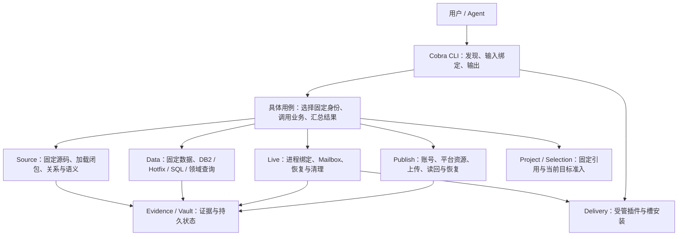

# Lychee Dev Go 业务整改计划

日期：2026-11-03。实施基线：main `a8fdb7fc8464f06c1cffbd05e6648e124edcb0e2`，发行版本仍为 3.2.7。

本文整理用户要求的 Cobra、Agent CLI 自解释、Skill 精简、DBCD/Data、SQL、Source、Publish、正式 Forever 支持、代码与测试清理、CI减负，以及整体业务架构和循环审计—修复流程。前一轮整改、离线验收与独立复审已完成；**追加的DuckDB迁移已实现，旧SQL引擎已删除，无旧方言兼容、引擎开关或回退**。第7节记录迁移方案与实际验证范围。真实平台、客户端和云端CI验收继续单列待办。现有实现见 [Design.md](../Design.md)，后续工作见 [todo.md](../todo.md)，交接状态见 [handover.md](../handover.md)。

审计结论分为三类：已确认代码问题、需独立样本复现的候选差异、需要明确合同的设计选择。静态代码确认、离线回归、真实客户端/平台验收和发布分别记录。main 基线此前通过的完整套件作为既有证据保留，新方案按改动重新验收。

当前实施状态（随收尾替换，不作为逐轮运行记录）：

| 范围 | 当前结果与待验 |
| --- | --- |
| Data / Forever / SQL | 前轮NotPublic、copy/Common、身份与导入准入修复和差分已完成。DuckDB 2.0.0已接入，旧引擎50个源码/测试文件已删除；迁移验证见7.7 |
| Source | 已修正条件加载、coverage、environment、分页身份与真实 Git fixture 路径；第三轮全新审计无新增可复核问题 |
| CLI / Skill / CI / 清理 | Cobra 和离线合同已接入，Skill 精简；CI去重、真实终态、DBCD摘要与旧导入规则已修；第三轮全新审计无新增，独立Skill任务和最终Publish CLI状态查询复审完成。云端耗时收益待测 |
| Publish | 五平台已实现并接入CLI；DD第11轮、公共层/CF/NewBee第9轮、ModUs/Blackbox第11轮全新复审均无新增可复核问题。真实账号/平台写入和游戏操作未执行 |
| 集成验收 | DuckDB最终候选完整Go/Lua通过35包、3455条通过事件、30项环境/helper skip、exit0；固定DBCD、真实LuaLS和跨盘用例已执行。原生CLI、隔离npm安装、351命令Skill合同、843个Go文件导入合同和actionlint均通过 |

## 1. 范围与固定依据

| 依据 | 固定基线 | 用途 |
| --- | --- | --- |
| 当前 Go 产品 | main `a8fdb7fc8464f06c1cffbd05e6648e124edcb0e2` | 保留现有业务、结果合同和恢复语义 |
| 同仓库 Rust 版本 | 本地 `Rust-refactor`，`92bdb2bdbaa383db7e90dd585ecb01a3c4464563` | 参考 CLI 信息组织、精简 Skill、Forever 身份及 Publish 业务边界 |
| [Cobra](https://github.com/spf13/cobra/releases/tag/v1.10.2) | `v1.10.2` | Go 命令树、参数和执行上下文 |
| [DBCD](https://github.com/wowdev/DBCD/tree/c0aeb5f6be0e9fbffc8eadb4f8b9b4e36b42af7c) | `c0aeb5f6be0e9fbffc8eadb4f8b9b4e36b42af7c` | DB2/DBD 和 Hotfix 读取语义的独立对照 |
| [Fuploader](https://github.com/Follen/Fuploader/tree/134cba232f5ae84109bb35d9eafe1093399edc1b) | `134cba232f5ae84109bb35d9eafe1093399edc1b` | 发布平台、动作、字段、会话、备份和读回合同 |

DBCD 与 Fuploader 的提交已通过 GitHub 核实。后续更新对照基线时记录具体差异，避免测试运行时随默认分支漂移。Rust 参考包括其 `DESIGN.md`、`FUPLOADER.md`、Skill、CLI discovery/contract、产品目录和相关业务实现；Go 方案按当前模块与实际需求选择借鉴内容。

当前实施复用当前 checkout，不操作账号或发行渠道；DuckDB按追加指令实施直接替换，保留无关修改及有效用户数据；commit、推送、发布和真实外部写入按当时用户指令执行。

## 2. 整体业务架构建议

### 2.1 业务分工

建议保留 Go CLI、Lua addon、单一 Agent Skill 和 npm 分发的组成。现有 `internal/codebase`、`internal/records` 等目录先保持稳定，按实际职责拆分大函数和依赖；模块改名与文件搬迁以减少真实耦合为依据。



| 边界 | 建议职责 | 应收敛的耦合 |
| --- | --- | --- |
| CLI 适配 | Cobra 命令树、flags/stdin/file 绑定、输出格式、退出码 | 业务模块接收具体请求类型，减少共享大 Options 和字符串路由分支 |
| 用例编排 | 固定选择、跨域调用、证据关联、阶段结果汇总 | 先拆为明确函数；出现真实多入口复用后再决定是否提取独立 application 包 |
| Source | Git 固定树、文本、加载顺序、API environment、语义和覆盖状态 | 仓库 track、客户端产品、Data build 各保留自己的含义 |
| Data | DBD 选择、物理解码、Hotfix overlay、SQL 和领域关系 | 单表与领域/SQL 共用相同 reader、固定身份和预算，减少平行查询路径 |
| Live | 固定实例、输入意图、Mailbox 状态、原请求恢复与资源清理 | 保持现有协议、500 槽和单一输入 owner，不将平台发布会话套入游戏状态机 |
| Publish | 平台输入语义、账号与资源身份、上传/登记/读回、原操作恢复 | 平台差异位于各平台模块；真正共用的归档、HTTP 和结果处理复用小函数 |
| Delivery | 本机 CLI/Skill/addon 的受管安装与升级 | 与远端作者发布分别提供明确入口及结果 |
| Evidence / Vault | 不可变来源、CAP、缓存与必要恢复状态 | 缓存回收与用户证据删除分开，保留原日志和未知操作的恢复单位 |

### 2.2 身份与结果合同

1. 区分当前支持产品目录、历史固定记录、安装位置、来源配置和运行时身份。当前目录决定新目标是否可选；历史记录按创建时的身份读取。
2. 联合调查明确携带 Source PIN、API environment PIN、Data PIN、Changes/Hotfix CAP。调用层组合这些证据；相同产品或版本字符串不自动证明它们可叠加。
3. 第三方源码 track（例如 `main`）保持仓库含义。若现有项目锁表达不了联合调查，先以显式多引用完成用例，再按需要设计锁格式演进；旧 PIN 哈希与内容不重写。
4. 业务模块提供类型化结果和结构化错误，CLI 在出口统一映射 `lycheedev.result.v1`、JSON/JSONL 与退出码。字段级错误带路径和适用下一步。
5. 分别表达来源覆盖、查询完成、输出截断、业务成功、外部写入状态和清理状态。聚合结果由实际请求的阶段计算，避免各字段相互矛盾。
6. 资源预算保留在拥有读取/分配/执行行为的边界。先核算现有重复计费、实际峰值和并发容量，再调整限制。

### 2.3 复杂度控制

新增接口或状态前，先说明触发场景、影响、可复现输入和维护成本。只为真实共享行为抽取公共实现。普通操作沿用一份必要的当前状态；未知提交、上传收据和原产物身份按真实恢复需要保存。SQL 优化器、后台服务、跨平台插件框架及通用事务系统均需单独的实际收益证据。

## 3. Cobra 与 Agent CLI 自解释

### 3.1 唯一命令合同

整改基线的 [command_contract.go](../internal/command/command_contract.go) 维护 83 条命令，[entry.go](../internal/command/entry.go) 同时承担大量解析、转换和编排。现已保留 `command_contract.go` 作为唯一命令注册目录，扩充类型化定义并由其构建 Cobra 树；新 Publish 命令也从该目录生成帮助与 schema。

定义应包含：命令路径与业务用途、位置参数、flag 类型、必填与条件必填、默认值、枚举/范围、重复参数规则、互斥/依赖、输入模式、执行处理器、结果结构、示例和实际影响。嵌套业务输入由所属领域的输入定义负责，CLI 引用同一合同生成 schema 与执行准入。

迁移中逐组改接现有用例，最终删除被替代的旧解析和路由分支。Cobra 不再调用完整旧 `parseOptions`。保留 `Execute(ctx, args, stdout, stderr)` 这类可嵌入、可取消、可测试的外部入口；每次调用创建独立命令实例，避免参数状态跨调用泄漏。

关键回归：未知命令/参数、位置参数与 `--`、路径空格、`--flag=value`、显式零值和布尔值、非法重复参数、允许重复的 `--param` 与多安装目标、取消和期限。参数错误同样按请求的 `--format` 输出，Cobra 的 usage/error 不混入机器结果正文。

### 3.2 推荐命令骨架

以下为拟议接口，正式实现前形成现有每条命令的映射表：保留、合并、改名或退役，注明原因、调用者与验证。保留底层业务能力，命令数量不作为完成标准。

```text
lycheedev discover "<业务问题 / 平台 / 产品俗称>"
lycheedev schema <command...>
lycheedev <command...> --help

lycheedev source ...             # 固定源码、查询、关系、上下文、验证
lycheedev data table ...         # 拟整理现有 db2 schema/rows/search/关系/stream
lycheedev data sql ...           # 只读 SQL、参数、EXPLAIN / ANALYZE
lycheedev data hotfix ...        # 原始 Hotfix 与显式 overlay 的来源
lycheedev data <领域> ...        # spell/item/creature/encounter/decor
lycheedev asset ...              # 资源发现、查看和导出
lycheedev live ...               # 实例、连接、执行、恢复和清理
lycheedev publish <平台> ...     # 作者发布与云备份
lycheedev project ...            # 项目上下文和固定锁
lycheedev target ...             # 目标发现、固定解析和已存配置
lycheedev evidence ...           # 证据读取、核验、保留和显式删除
lycheedev cache ...              # 缓存状态、核验和回收
```

安装、Skill/addon 管理、配置、update 与统一 doctor 同批检查命名和副作用说明。完整目录仅在用户需要时返回；`describe` 的保留或迁移纳入映射表。必要旧别名直接调用同一新处理器，并在合同中说明替代入口。

### 3.3 自解释内容与边界

| Agent 的下一步 | CLI 必须提供 |
| --- | --- |
| 发现能力 | 业务词、产品中文俗称、平台、资源、动作匹配到少量已实现命令 |
| 构造输入 | 精确类型、必填/条件字段、范围、互斥、stdin/file 方式、省略与清空语义、最小有效示例 |
| 选择动态值 | 分类、版本、套餐、频道、账号/角色、关联对象的查询入口和父级身份 |
| 判断影响 | 本地写入、网络读取、远端修改、登录/短信、凭据存储、SDK、提权和游戏输入的实际条件 |
| 理解结果 | 固定来源、完整性、partial/truncated/pending、已提交/已验证、产物和待清理状态 |
| 改正错误 | 具体字段、实际问题、期望值或格式、相关 schema/查询/恢复命令 |
| 继续未完成任务 | 原请求/会话标识、期限、合法状态查询与恢复动作，复用已有产物 |

`discover/schema/help` 读取静态合同和编译产品目录，在无项目、无缓存、无账号、无网络时工作，不初始化 home、不读取凭据、不启动 worker 或游戏。动态就绪检查由明确命令执行。产品发现与参数校验使用同一目录。

SQL schema 说明实际方言、可用函数、命名参数、数值精度、预算、EXPLAIN 结果及分页要求。Publish schema 提供平台嵌套输入，而非仅给出一个 JSON 文件参数。结果 schema 对齐真实输出类型；示例通过实际输入准入检查。

## 4. Skill 精简

main 基线正文 118 行，20 份 references 约 178 KB。精简先补足 CLI 的使用信息，再移除文档重复。

- 正文目标约一页，保留用途、Source/Data/Live/Publish 路由、产品俗称与规范身份、发现入口和少量必要约束。
- 删除逐条命令目录、完整字段表、固定版本/渠道推断、CLI 已负责的准备/恢复流程及内部研发状态。
- references 保留真正需要解释的证据边界、Source 分析语义、Live 探针设计等内容，按任务读取。
- 产品/版本速查与程序目录同源维护；完整 build、版本系列和 TOC Interface 分列。
- Publish 使用同一份 LycheeDev Skill；字段、账号/通道能力、动态选项和恢复算法由 CLI 说明。

验收使用独立 Agent，仅提供安装后的 Skill、CLI 和必要任务输入。代表性任务包括第三方 addon API 调查、固定 build 的数据与 SQL 查询、正式 Forever 选择、原 CON 恢复，以及发布输入准备和异常恢复。记录需要翻源码或研发文档的具体缺口，回补到对应 CLI 合同。最终按任务完成情况评价精简效果。

## 5. 正式 Forever 全链支持

### 5.1 产品定义

当前 main 的 Skill 已说明正式 Forever，但 [产品代码](../internal/selection/products.go) 仍主要采用两个 Beta 身份。本项负责把产品实现与使用面统一。

| 项目 | 正式合同 |
| --- | --- |
| 用户常用名称 | Forever、无限服、国服无限服 |
| CLI 规范产品 ID | `forever` |
| Source family / 上游分支 | `forever` |
| 官方远端产品码 / 安装 flavor | `wowf` |
| 客户端目录 / 可执行文件 | `_forever_` / `Wow.exe` |
| 已知版本系列 | `1.60.1.*`；完整 build 按固定来源或当前所选安装读取 |
| TOC Interface | `16001`，与 build ID 分别保存 |
| 当前目标产品集合 | Retail、Classic、Classic Era、Titan、Forever、Anniversary 六产品 |

`forever-asia-beta / wow_classic_beta` 与 `forever-cn-beta / wow_cn_beta` 退出新目标选择。`wow_forever` 不作为正式远端产品码。产品名称不决定 region/locale；用户请求、已固定项目和明确安装证据分别保留。

版本系列不构成数字 build ID 的最低/最高界限。参考记录中的 `1.60.1.70658`、`1.60.1.70707` 可作为已观察样本，只有固定输入复核后才进入本轮验收；不据此宣称整个区间都已支持或测试。

### 5.2 实施边界

| 业务层 | 需修改与核验的内容 |
| --- | --- |
| 目录与发现 | 单一产品目录、中文俗称、CLI schema/帮助、Skill 速查一致；新选择不列 Beta |
| 安装识别 | 交叉核对 `.flavor.info`、存在时的 `version.txt`、共享根 `.build.info`；目录仅用于定位，支持精确客户端路径，冲突明确返回 |
| Source | 正式 `forever` 指向正确源家族及固定提交；共享旧分支不证明 Data/Live 属于正式 wowf |
| Data / Changes | 本地 CASC、远端版本/CDN、DBD、Hotfix 和缓存键保留正式产品/build/config/region/locale；各新入口执行当前目标准入 |
| 导入与父引用 | `target resolve --file`、命名目标、`--from` 等都覆盖正式准入；结构合法与当前产品可选分别校验，父 PIN 保持不变 |
| Delivery | 正式安装识别、主插件与500槽清单、升级/修复/卸载均使用同一身份；通过受管安装交付 |
| Addon | Compat、ClientGate、Interface、生成目录和 Mailbox 所报产品/build 对齐；保留功能关闭时的无额外运行成本 |
| Live | 进程选择、运行时配方准入、新鲜 INPUT、安装/PID/创建时间/HWND 与角色/runtime 绑定逐层核实正式身份 |
| 分发与文档 | 发行输入、版本检查、支持矩阵和使用示例同步，实机覆盖单独记录 |

安装元数据冲突不靠编辑用户游戏元数据解决；正式产品缺失时返回明确选择问题，不回退 Beta 目录、端点或缓存。

### 5.3 历史记录与恢复

- 历史 PIN、CAP、原始 DB2/Hotfix、输入和未完成恢复保持原产品、build/config、父引用和哈希。
- 旧 PIN 的 `product=forever` 可能来自旧映射，需读取原来源身份；名称相同不自动升级为 `wowf`。
- 历史数据读取与新目标准入使用不同判定目的。历史材料保持可解释；新的执行或绑定仍核当前实际目标。
- 旧 Live 连接沿原 project/CON/request 处理原结果与清理，新正式进程使用独立绑定，未知输入不重放。
- 本轮不批量转换用户历史数据，也不以删除旧数据来完成 Beta 退役。

### 5.4 验收矩阵

离线覆盖：精确 wowf flavor、仅有匹配 wowf catalog、缺失可选版本文件、元数据冲突、改名目录、错误 exe、共享安装、Beta 新目标拒绝、旧 PIN 可读、文件导入旁路、父 PIN 冲突、缓存隔离、独立 PID 与旧连接恢复。

真实输入覆盖：固定正式 Forever 的 Source、DBD、DB2、Hotfix、资源与 SQL 结果；缺钥和 partial 如实保留。受管交付和 Live 实机按用户安排单列验证：安装/升级、首次激活、连接、执行、报告、清理和断开。离线身份通过不直接扩大实机矩阵。

## 6. DBCD 对齐与 Data 正确性

### 6.1 已审计结论

当前 DBCD oracle 固定 `e732093f8864240fc5884bd1bba6b02f3dfc0d56`，与最新固定提交之间只有一项 NotPublic Hotfix 修正。追踪该差异与全面检验 reader 边界分别开展。

| 编号 | 分类与证据 | 修复或验证方案 |
| --- | --- | --- |
| DATA-01 | 确认缺陷：[effective.go](../internal/records/effective.go) 基线72–133行接受状态4，并将其作为无效记录删除；上游 [HotfixReader](https://github.com/wowdev/DBCD/blob/c0aeb5f6be0e9fbffc8eadb4f8b9b4e36b42af7c/DBCD.IO/HotfixReader.cs#L107) 对 NotPublic 返回 Ignore | 显式区分现代 Valid/NotPublic/其他状态；NotPublic 保留已有 patch 或基础行，维持旧缓存及 TACTKey 特例 |
| DATA-02 | 确认验收缺口：[Program.cs](../tests/dbcd/Program.cs) 只输出最多200个字段样本且不应用Hotfix；标签未绑定实际源码；[compare](../tests/dbcd/compare/main.go) 比较前移除 sourceCommit | 固定实际构建SHA、DBD与输入摘要，增加全字段流式摘要/分块差分、Hotfix模式，接入现有CI证据检查 |
| DATA-03 | 候选缺陷：[view.go](../internal/records/table/view.go)、[records.go](../internal/records/table/records.go) 用 OriginID 查 Common；上游copy行按逻辑目标ID查询 | 构造origin/目标各有覆盖、仅origin覆盖和默认值样本，走双方正式reader；结合真实表决定语义，保留字符串偏移/inline ID/关系值正确性 |
| DATA-04 | 设计差异：[definition.go](../internal/records/schema/definition.go) 优先layout，上游 [DBCDBuilder](https://github.com/wowdev/DBCD/blob/c0aeb5f6be0e9fbffc8eadb4f8b9b4e36b42af7c/DBCD/DBCDBuilder.cs#L41) 优先build | 对一致、冲突、仅build、仅layout、歧义建立矩阵，记录有意差异；真实兼容需求驱动精确调整 |
| DATA-05 | 范围差异：[layout.go](../internal/records/table/layout.go) 主要读取WDC2–5，上游 [DBParser](https://github.com/wowdev/DBCD/blob/c0aeb5f6be0e9fbffc8eadb4f8b9b4e36b42af7c/DBCD.IO/DBParser.cs#L39) 还支持旧格式 | 统计六产品真实输入，CLI公开可读格式；按实际目标补旧格式及对应差分 |

以上为静态审计结果。DATA-01 的独立行为复现、DATA-03 的语义确认和新增对照执行属于实施阶段。

### 6.2 深度对齐矩阵

覆盖字段位宽与符号、u64精度、浮点、数组、字符串相对地址、多section、压缩类型、sparse、copy链、relationship、加密分区和缺钥，以及DBD build/layout选择。Hotfix覆盖v7/v8/v9、同ID多次状态转换、跨capture顺序、删除、NotPublic和特殊表。

DATA-01至少验证基础行→NotPublic、Valid→NotPublic、Delete→NotPublic、NotPublic→Valid，比较最终字段及删除计数。差分工具应能发现第201行后的字段修改、u64高位错误、copy/Common差异和错误上游SHA。

对照工具保持测试用途，不进入发行运行时。DBCD用于解码和Hotfix语义对照；SQL表达式和执行语义另行验证。上游写回能力与当前只读Data业务分别评估，不因上游具备某功能就自动扩大产品范围。

## 7. DuckDB 接入与 SQL 迁移

### 7.1 方向与当前状态

用户已追加要求：**按计划实际接入 DuckDB，删除自研 SQL 解析、执行和优化层，不留旧兼容**。当前[sql.go](../internal/records/sql.go)调用[sqlengine](../internal/records/sqlengine/query.go)；生产代码、测试入口和发行包使用DuckDB执行路径，旧`internal/records/relational`已删除。

不增加引擎选择参数、旧方言翻译器、失败后回退或兼容 build tag。SQL统一采用DuckDB语法；旧 `:name` 参数、私有函数和EXPLAIN结构按新合同迁移，更新调用者、示例与测试。既有PIN/CAP和历史证据文件保持原内容，这些数据读取不需要保留旧SQL引擎。

DB2/DBD 解析、CASC/CDN 读取、Hotfix 叠加、固定 PIN、来源覆盖和证据链继续由当前 Data 模块负责。中间增加或调整必要的数据适配，把经过身份和覆盖核验的类型化数据交给 DuckDB；SQL 引擎不接管原始游戏格式、来源选择或完整性判断。

前轮SQL-04的100×100合成样本与其他SQL场景作为迁移测量输入；独立预期保留，旧优化器内部计数和专用测试随实现删除。迁移前后的测量覆盖相同输入、参数与来源范围；不在生产包中保留对照引擎。

### 7.2 适配边界

| 层次 | 迁移职责 |
| --- | --- |
| Data reader | 保留DBD选择、物理解码、ID/外键索引、选列能力、固定build/config/region/locale和当前预算 |
| Hotfix effective | 按明确CAP顺序叠加并保留删除/NotPublic/缺失范围，向适配层提供结果与独立coverage |
| DuckDB适配 | 验证合适的扫描/批量输入或表函数接口，传递精确类型和需要的列/过滤条件；按请求释放资源 |
| SQL | 解析、绑定、执行、JOIN/聚合/子查询与优化由DuckDB承担；只开放任务需要的只读查询能力 |
| CLI与证据 | 继续输出lycheedev.result.v1、原PIN/CAP、partial/truncated与查询完成状态；EXPLAIN指标说明改为实际引擎含义 |
| 包装 | 固定DuckDB/Go绑定版本、Windows amd64 ABI及构建输入；核算CGO、原生库体积、分发与重建成本 |

**单ID和35-ID查询不得因接入DuckDB而先导入整张表。** 先验证既有reader索引如何进入实际查询计划；若某种绑定只能整表物化，则记录其代价并选择适配方案，不能仅用已导入后的SQL耗时掩盖数据读取成本。

### 7.3 固定样本验证矩阵

| 编号 | 必需场景 | 验收证据 |
| --- | --- | --- |
| DUCK-01 | 单ID、35-ID SpellName、ID集合加过滤、少量列/全列 | 查询计划、实际reader扫描/lookup/解码量；不发生无谓整表导入 |
| DUCK-02 | 多表JOIN、小表对大表、重复键、外连接 | 与独立预期一致的行/字段摘要、NULL及重复行语义；端到端耗时和峰值 |
| DUCK-03 | 聚合、DISTINCT、CTE、相关/无关联子查询、排序与LIMIT | 基数、分组、空表、排序并列与OFFSET行为；注明方言迁移差异 |
| DUCK-04 | uint64高位、int64符号边界、浮点、数组、NULL、混合类型 | 无float64中转造成的整数精度损失；绑定、返回值和JSON/CSV/JSONL输出一致 |
| DUCK-05 | 取消、期限、内存上限、并发与临时文件 | 原期限传递、实际中断、资源释放、RSS/提交内存/临时磁盘峰值；避免reader与引擎双重计费失真 |
| DUCK-06 | 缺钥、加密分区、缺定义、Hotfix effective、截断 | 引擎返回行不提升来源coverage；partial/缺失/输出截断与查询完成独立 |
| DUCK-07 | 本地冷/热缓存、CDN准备、跨CLI重复查询 | 固定PIN/DBD/原始输入/参数；分别记录网络、读取、转换、导入、SQL执行和输出成本 |
| DUCK-08 | Windows amd64 CGO、原生库、发行安装与独立重建 | 工具链/库版本与摘要、包体积、加载依赖、隔离安装及对应源码重建；无开发机隐式依赖 |

沿用可重复生成的算法样本，并补固定真实PIN输入。比较旧引擎与DuckDB时使用相同数据、参数和覆盖范围，计入读取和数据转换耗时，不仅比较SQL执行阶段。测量扫描行数、lookup次数、解码量、分配、逻辑预算、进程内存和临时文件峰值，以及端到端耗时分布；冷/热缓存与CDN准备分别呈现。

### 7.4 实施顺序与文件边界

| 阶段 | 具体改动 | 完成条件 |
| --- | --- | --- |
| D1：固定依赖与原生验证 | 固定官方 `github.com/duckdb/duckdb-go/v2`、bindings和Windows原生库；验证本机UCRT GCC构建、只读语句准入、取消、uint64、表函数与投影接口 | 真实DuckDB执行样本通过；记录版本、摘要、原生依赖和API限制 |
| D2：Data适配 | 新增单一SQL引擎包；改接 `prepared.go`、`effective.go`、`semantics.go`，提供确定的列类型、流式扫描、ID查找和来源计量 | DUCK-01/04/06通过；点查不整表物化；投影减少实际解码，Hotfix语义和coverage保持 |
| D3：查询入口与业务合同 | 改接 `sql.go`、`query.go`、CLI schema、JSON/CSV/JSONL和EXPLAIN；SQL解析/绑定/求值由DuckDB执行，参数采用原生 `$name` | 单条只读查询；禁止SQL外部文件/网络和扩展加载；缺参、多参、取消、错误退出与原始来源验证正确 |
| D4：直接删除旧实现 | 删除整个 `internal/records/relational`；共享Data数据结构迁到实际使用边界，业务测试转为独立预期的DuckDB回归 | 无旧包引用、无旧方言重写、无引擎开关/回退；不把旧解释器复制到新目录 |
| D5：Windows交付 | 调整 `tools/release.mjs`、`tools/ci-inputs.mjs`、CI/release workflow、第三方许可与源码重建输入；退役 `CGO_ENABLED=0` 发行声明 | CGO开启且工具链明确；隔离npm安装能执行真实SQL；原生依赖随包或静态链接，产物不依赖开发机PATH |
| D6：集成与收尾 | 执行DUCK矩阵、build/vet、受影响测试、Lua必需完整Go套件、相关Node与包装检查；同步Design/Skill/todo/handover | 实际通过项与外部待验分别记录；版本及npm渠道保持3.2.7/latest，不提交或发布 |

上述实现由主Agent集成，复用当前main工作区。D1至D5已完成，D6实际验收见7.7；真实输入补验单列，不与实现完成混写。中途实验放在 `.tmp/duckdb-migration/`，按现有清理规则收尾。

### 7.5 关键决策与成本控制

- 官方Go驱动固定为 `v2.20000.0`（DuckDB `2.0.0`），bindings与原生库固定为`v0.20000.0`，已记入go.mod/go.sum。实际API以该tag源码为准，见[官方说明](https://github.com/duckdb/duckdb-go/blob/v2.20000.0/README.md)，无运行时下载引擎。
- 优先使用官方表函数和列投影接口。若绑定不提供过滤下推，只对DuckDB自身解析得到、能够证明安全的简单ID等值/集合条件传递reader查找范围；谓词仍由DuckDB计算。复杂查询走同一流式表源，不新增SQL解析器或通用优化框架。
- 只读准入基于DuckDB解析和语句类型。每次查询使用独立内存数据库，明确禁止外部访问和扩展自动安装/加载；不把用户SQL交给会执行前置语句的多语句Prepare路径。该限制对应SQL从只读游戏数据越界到宿主文件/网络的具体风险。
- 内存限额、线程、取消与输出预算在实际拥有资源的边界设置；取消测试覆盖原生查询和reader回调。区分DuckDB内存限制、Go保留数据和进程峰值，不叠加虚假的统一RSS保证。
- 不引入持久DuckDB缓存、后台服务或自定义C++扩展。官方驱动的Arrow模块作为间接依赖出现在go.mod中，仅用于其可选build tag；当前CLI编译依赖图没有Arrow。

### 7.6 最终删除清单

- `internal/records/relational`中的扫描器、语法树、绑定器、表达式、JOIN、聚合、递归、排序、子查询缓存和旧EXPLAIN实现全部删除。
- 只断言旧算法选择/内部work计数的测试删除；ID查询、精度、Hotfix、缺钥、参数、只读、取消和输出场景迁到新的业务回归，保留独立预期。
- CLI发现、schema、Skill、基线目录、错误映射、构建与许可中旧引擎引用同时清理。旧语法示例改为DuckDB写法；不接受后再悄悄改写。
- 旧性能日志与临时对照程序不进入发行包；复用现有临时材料清理规则。真实平台、游戏和云端CI仍列后续工作。

### 7.7 实际迁移结果与后续验收

| 范围 | 已执行结果 | 后续补验 |
| --- | --- | --- |
| DUCK-01 | 单ID/35-ID经本地归档和离线CDN fixture准备链分别供给1/35行；原生EXPLAIN和Data scans分别报告计划及实际读取；投影回调通过。追加审计修复表列重命名导致ID等值/IN漏行，回归先红后绿 | 固定真实SpellName PIN重放 |
| DUCK-02/03 | JOIN重复键与外连接、聚合、DISTINCT、CTE/递归CTE、相关/非相关子查询、排序、LIMIT/OFFSET按独立预期通过；同表多作用域不误用ID限制 | 真实数据规模与旧基线的同输入性能对照 |
| DUCK-04 | uint64/int64边界、DECIMAL、数组和NULL原生结果及精确JSON通过；CLI JSON/CSV与现有JSONL合同回归通过 | 真实DBD混合字段样本补验 |
| DUCK-05 | 原生期限取消、LIMIT提前结束后的reader释放、供行/结果预算、外部文件/网络拒绝及sqlengine race通过；24项准备链基准进程按100ms采样，working set峰值约51MiB、private约75MiB | 大输入、多进程并发和临时磁盘峰值测量；64MiB为DuckDB缓冲限制，非进程RSS上限 |
| DUCK-06 | 现有缺钥/partial、Hotfix effective、来源变更、错误和截断合同回归沿新引擎执行；固定DBCD物理解码与Hotfix差分另列 | 六产品固定真实输入矩阵 |
| DUCK-07 | 1000行合成数据的24项本地/离线CDN、冷/热准备链基准通过，含单查、JOIN、子查询、static/effective、Hotfix删除和导航；SQL端到端约73–211ms，导航约236–554ms | 真实网络冷CDN、分阶段成本与旧实现同输入对照；当前结果不计算加速比例 |
| DUCK-08 | Windows固定GCC14.2、CGO静态构建、系统PATH启动、原生SQL/CSV/Hotfix/资源导出及隔离npm安装通过；工作区快照vendored离线重建字节一致；完整许可随包 | tag发行流水线、云端runner；DuckDB C++从源码重编译未执行 |

原生CLI约140.5MB，含LuaLS的开发npm包约46.3MB；相较此前约29.5MB的CLI，体积增加来自静态原生引擎。对应源码快照约202.4MB；归档改为逐文件流式压缩。移除含本地库搜索路径的链接build ID后，离线重建字节一致，VCS身份和产物SHA256继续保留。新增依赖使CLI超过旧LuaLS peer核验的128MiB上限，该上限已按当前包体调整到256MiB，真实跨CLI broker回归通过。

代码批次build/vet、受影响SQL/Data/CLI测试、98项Node检查、最终351命令Skill合同及843个Go文件导入合同通过。最终原生包与npm隔离安装均通过；完整Lua5.1必需Go候选套件使用`-p=2 -parallel=4 -count=1 -timeout=0 ./...`，35包、3455条测试通过事件、30项环境/helper skip、0失败、exit0。真实跨CLI broker、打包Source语义、DBCD Hotfix差分和跨盘备份均实际执行；actionlint及本地文档链接检查通过。当前没有提交、推送、发布、真实平台写入或游戏操作。

## 8. Source 边界整改

| 编号 | 分类与证据 | 推荐方案与行为验收 |
| --- | --- | --- |
| SOURCE-01 | 确认能力缺口：[toc.go](../internal/addoncheck/toc.go)、[xml.go](../internal/addoncheck/xml.go)、[closure.go](../internal/addoncheck/closure.go) 未完整处理条件加载与 `[Family]`/`[Game]` | 在现有闭包边界加入来源明确的客户端上下文；同树分别验证Mainline/Classic、排除分支缺文件、未知条件partial、占位符与加载顺序 |
| SOURCE-02 | 确认不一致：[context.go](../internal/codebase/context.go) 基线413–423行可能保留总体complete状态，却因flow返回`complete=false` | 汇总所有被请求阶段的coverage；验证完整refs+非截断flow unknown、遗漏文件、unsupported及完整bounded flow，CAP与正文一致 |
| SOURCE-03 | 合同问题：[environment.go](../internal/codebase/environment.go) 对Blizzard Source静默忽略显式environment | 建议使用自身环境并拒绝冲突参数；第三方Source明确要求合法客户端环境。相同/不同/不存在环境PIN均有行为测试 |
| SOURCE-04 | 候选：分页指纹弱于 [semantic_cache.go](../internal/codebase/semantic_cache.go) 所用语义上下文身份 | 先复现同二进制、不同有效上下文续页；复用已有身份指纹，保持同上下文正常分页 |
| SOURCE-05 | 模型限制：第三方track `main`与Data产品组合受 [pins.go](../internal/selection/pins.go) 产品检查限制 | 用例层明确持有Source/environment/Data独立引用，验证第三方源码联合调查；保留跨产品拒绝和父记录不变 |

保留已有显式snapshot优先、固定commit、原始字节和哈希、编码告警与语法诊断分离、完整语义缓存准入等机制。新增上下文从固定产品事实产生，不用版本号猜加载家族。

## 9. Go Publish 业务

### 9.1 能力映射

建议新增 `internal/publish`，按平台分模块，CLI统一使用 `lycheedev publish`。对照固定Fuploader列出每项原业务、新命令、输入合同、执行器、动态选项、读回和恢复验收；原命令的改名与合并保持业务可达。

| 平台/通道 | 范围与关键边界 |
| --- | --- |
| CurseForge | 作者公开项目、动态游戏版本、已有项目ZIP上传及状态/结果验证；查询Key与上传Token分开，保持原Project创建/枚举范围 |
| NewBee 官方 | 官方CLI发现、认证检查、资源/版本、长文本/媒体、工程初始化/拉取/同步/打包/上传；按实际已安装官方能力执行 |
| NewBee Creator | 桌面会话、动态选项、插件/配置/WA、版本/日志/媒体、共享码、联合作者/引用关系及选择性备份 |
| 网易DD | 任务会话、动态选项、插件/配置/WA、版本/频道及备份；借用GUI会话时保持原账号，只清理本任务运行环境 |
| 小黑盒 | 短信/微信、会话状态与续期、插件/版本、配置、公开WA和选择性备份；隐藏/审核状态与访问隔离分别解释 |
| ModUs 主客户端与Creator | 两类账号来源分别处理；项目/依赖、版本/媒体、配置/WA、原生备份格式、引用保护和逐项恢复 |

官方与桌面通道使用明确的发现结果和选择，不静默切换。真实任务需要的账号、资源、内容和动作沿用既有用户授权；缺失的业务选择由CLI说明。

### 9.2 Go 实现与外部依赖

业务、输入、HTTP、归档、读回与恢复用Go实现，复用现有交付和npm包装。厂商SDK能力保留窄Windows适配，单独说明依赖与诊断；不携带第二套Fuploader Python CLI/venv/安装器。

DD的签名、登录、WA解析及会话生命周期先做原生接口验证，确认位数、接口调用、所有权、期限和退出行为，再展开全部业务。必要厂商运行时属于明确外部依赖。NewBee官方通道复用其正式CLI，不复制其私有认证逻辑。

### 9.3 输入、计划与恢复

- JSON严格区分省略、清空、null、false、0和空数组；未知字段、重复键和非法数值在入口报告。平台编辑保留未修改的嵌套对象。
- schema与实际解析使用同一字段定义；条件字段、动态选项和最小有效示例随执行器交付。
- `--plan`仅做本地准入和改动说明，标明仍需远端查询的条件，不读取凭据、不登录、不提交。
- 列表保持真实分页与partial；备份只收集明确选择的插件、素材、账号、服务器和角色，原归档复用。
- 保存原目标、原文件摘要、必要上传收据和当前操作状态。未知提交先查原目标，已完成批次项不重做。
- 区分上传、版本登记、元数据读回、CDN字节验证、审核和清理；CDN尚未更新时保留待核验状态。
- 日志和普通结果不含秘密、原始WA/配置正文或签名URL。账号身份与业务资源身份分别核验。

离线测试核最终请求、字段保留/清空、动态选项、分页、读回差异、断点恢复和产物复用。SDK、账号和真实平台写入按独立验收记录，不由离线成功推导。

## 10. 死代码与测试清理

| 编号 | 已核事实 | 清理顺序与应保留覆盖 |
| --- | --- | --- |
| CLEAN-01 | [CI doctor专项](../.github/workflows/toolkit-ci.yml) 基线182行仍运行command包，而三项测试已迁到 [channel](../internal/live/channel/doctor_repair_windows_test.go) | 优先从完整套件提取三项实际run/终态及卷信息；需独立失败诊断时使用正确包定向执行并核事件。完整套件仍覆盖这些测试，专项空跑单独修复 |
| CLEAN-02 | DBCD工具在完整Go套件中只编译，未进入实际差分；实际源码身份与硬编码标签未绑定 | 与DATA-02合并，错SHA、缺输入、未执行或结果不一致均失败；缺钥/partial单列 |
| CLEAN-03 | [IndexFixtureSource](../internal/codebase/usecases.go) 仅测试调用，生产读取分流到fixture；[打包Source测试](../internal/command/source_package_test.go)也先注入此索引 | 契约和打包测试改用最小真实Git提交，走正式sync/index/read；迁完再删合成PIN、FixtureRoot及平行搜索，保留parser fixtures |
| CLEAN-04 | [entry.go](../internal/command/entry.go) 中`--passive`、`--no-cache`不改变实际行为，部分测试仅固定兼容形式 | 在新命令映射中决定退役，连同解析/帮助/对应接受测试一起处理；保留零游戏输入和新鲜身份校验的实际测试 |
| CLEAN-05 | 仅测试使用的默认键helper、部分encoding薄包装处于生产代码 | 低优先整理到测试边界，保留有效fuzz、异常输入和预算入口覆盖 |

进一步按生产调用者、正式入口、实际断言、CI执行路径审查。测试使用helper、有条件skip或函数内没有直接Fatal，不等于无效。环境不足的skip、父测试核验的subprocess、既有缺陷回归保留其证明范围。

当前续审使用固定`golang.org/x/tools v0.41.0`调用图工具核对Windows生产与测试入口：删除无消费者函数；测试专用默认绑定、解析和定位便捷函数移入测试文件。Source规则测试直接经`environment.Build`和`RulesFromFacts`验证，删除重复摘要及无人使用的包装入口；Hotfix、DD与LuaLS测试直接调用现行入口。历史记录构造、原始格式解码和接口实现按实际测试消费者保留。包含测试的最终调用图无不可达函数报告；这项结果仅覆盖当前Windows构建配置。

旧解析器、重复命令表生成器、无人消费的元数据快照与失去用途的脚本，在新路径覆盖其业务后删除。有效用户数据、历史PIN/CAP、真实输入、活动工作区和未解决恢复记录不属于死代码清理对象。

## 11. CI 减负

### 11.1 已观察到的重复与必须区分的验证

本节依据当前 [toolkit-ci.yml](../.github/workflows/toolkit-ci.yml)、[toolkit-release.yml](../.github/workflows/toolkit-release.yml)、[baseline.mjs](../tools/baseline.mjs) 和包装脚本的静态检查。尚未采集本轮流水线耗时，优化收益通过后续同类运行比较。

| 编号 | 当前证据 | 减负建议 |
| --- | --- | --- |
| CI-01 | `windows-contract`已执行带coverage的完整Go/Lua套件；`windows-process`又执行process/delivery/vault/selection/journal包；`windows-addon`又执行addon/protocol/codebase | 按测试名、环境、构建参数和证明目标核重叠。相同场景只执行一次，专项作业读取本次真实事件形成报告；不同环境或独立进程行为继续执行必要场景 |
| CI-02 | contract与addon作业分别从同一固定Lua源码构建解释器 | 在同一工具链/平台下构建一次，传递Lua二进制、来源和哈希，消费者校验后使用 |
| CI-03 | package作业先构建release exe，[install-smoke.mjs](../packages/npm/lycheedev/test/install-smoke.mjs)随后自行再构建；部分发现/Skill检查使用`go run` | 显式向消费者传入身份匹配的CLI/产物；为现有工具补必要输入参数，改接后删除隐式重建路径 |
| CI-04 | doctor专项仍指向旧包，完整套件已有其测试 | 与CLEAN-01合并，正常运行从完整套件提取证据；确需独立故障定位时只补跑指定测试 |
| CI-05 | release工作流会调用完整CI，并另外进行正式组装、重建和包验证 | 清点每次调用证明的对象。先减少同一run内重复；跨run复用需精确SHA/tree、输入、构建配置与信任来源匹配 |
| CI-06 | 分支push与PR都可能触发，重型作业采用不同并发设置；目前仅过时PR允许取消 | 先观察同一变更的实际重复运行，再按精确被测提交和事件用途整理触发；保留merge_group及release对应对象，统一重型文件测试的有界并发 |

coverage、普通构建、race插桩、正式发布配置和独立源码重建具有不同证明目的。分别保留所需产物；同输入、同平台、同工具链、同flags的常规构建以一次生产为目标。可复现构建要求的第二次独立构建继续执行。

### 11.2 构建产物和测试证据复用

建议按“输入准备 → 必需构建 → 测试/包装消费 → 证据汇总”组织依赖：

1. 固定源码、Go/Node/npm/Lua、LuaLS、DBCD/DBD及CASC对照输入；来源不可变且有摘要。扩充已有构建/发行清单即可，不另建产物管理服务。
2. 对不同配置分别产出所需CLI、Lua、测试辅助程序和包。消费者读取本次明确指定产物；需要构建的subprocess/helper从测试消费者中逐步提到生产阶段，并保留真实子进程执行。
3. 同一份发行候选只组装/打包一次，结构检查、隔离安装、路径兼容和业务smoke消费原包，分别核身份与内容。
4. 完整Go套件继续在同次运行采集coverage和JSON测试事件。process/addon/doctor专项从事件中核对预期测试实际run及终态；缺失事件、零匹配、提前中止继续失败。
5. DBCD对照单独接入实际执行并复用已构建oracle；SQL微基准与真实数据测量明确分层，正常正确性CI无需每轮运行所有冷缓存网络基准。
6. 普通源码测试与“通过已安装TGZ调用”的测试即使同名，也可能验证不同入口。仅在来源、环境、执行路径与断言目的相同后去重。

缓存用于减少下载和编译成本；本轮验收依赖明确产物和执行记录。缓存命中不替代必需测试。PR merge提交、PR head、main提交及tag分别核对，不凭版本号复用结果；正式发布只使用信任来源且与发行身份完全匹配的证据。身份不匹配时执行对应验证。

### 11.3 变更范围与稳定检查入口

先建立少量可解释的变更分类：

| 变更类型 | 建议验证范围 |
| --- | --- |
| 仅开发说明文档 | 本地链接、引用路径、文档约束；不启动完整Go/Lua或安装矩阵 |
| Skill / Agent使用面 | Skill结构、实际CLI合同、必要任务场景及受影响包装检查；Markdown扩展名不等于纯开发文档 |
| Lua/addon/产品目录/协议 | 对应客户端矩阵、协议与加载合同、受影响Go集成；跨域身份改动进入完整验证 |
| Go业务与测试 | build/vet、受影响测试；最终候选保持完整Lua必需套件及适用race/集成要求 |
| 依赖、工具链、命令注册、CI、包装/发行输入 | 完整相关合同、构建与安装验收；不使用狭窄路径规则跳过未知影响 |
| 无法准确分类 | 使用完整验证范围 |

现有必需检查名称在工作流中有明确约定，实施时保持稳定，避免单纯改名、矩阵后缀或workflow级路径过滤导致缺失检查。使用始终运行的轻量分类/汇总入口：必需场景核实际结果，明确不适用的重步骤记录原因；取消、失败、缺产物、未知跳过和零执行不作为成功证据。若需改变外部分支保护配置，单独列出实际变更与用户操作，不假定配置已同步。

### 11.4 资源与收益验收

- 采集基线各job/step耗时、总runner分钟、关键路径、实际构建/测试次数、下载与artifact体积、缓存命中情况。冷/热缓存和PR/main/release分别比较。
- 优先删除已确认重复执行，再优化Lua/CLI/oracle准备及500槽测试输入。可共用只读准备材料，安装、升级、锁、崩溃恢复测试仍拥有独立可写目录和真实事务。
- 统一文件密集型包的有界并发；避免仅增加job数造成同机磁盘争用。保留`-timeout=0`和操作自身期限。
- 未经测量不设固定加速百分比。验收要求重复工作实际减少、总runner成本下降，并确认关键路径和失败诊断没有退化。
- 做负例验收：错误commit/hash、缺artifact、错测试名、helper未执行、必需Lua缺失、差分失败都能使汇总失败。覆盖减少或跳过增加必须有明确业务范围依据。

先完成CI-01到CI-04及低风险产物复用，再根据测量决定跨run复用、触发过滤或更细分片。race、真实安装、真实进程锁、独立重建及发布身份检查继续保留。

续审清除发行流程五个Linux作业中的Windows TMP准备步骤，修正原来要求所有作业保留该步骤的结构测试。原生工具链准备统一在固定Node配置后运行，下载artifact的action固定到仓库现用v4提交；必需job名称、并发上限、真实终态核验及发布渠道保持现行合同。对应15项本地CI检查和actionlint通过，云端成本与耗时继续后置。

## 12. 每轮新子Agent的循环审计—修复

用户要求Data、Source、死代码和废弃测试采用循环审计，直到没有发现新问题。该流程已在整改实施阶段启用。

### 12.1 每轮角色与输入

每轮创建新的三个子Agent，不复用上一轮Agent执行复审；协调者负责跨轮状态、问题裁定、文件边界和集成。

| 新Agent | 审计范围 | 必需输出 |
| --- | --- | --- |
| Data / SQL | DBCD对齐、固定身份、Forever、物理解码、Hotfix、SQL语义/预算/优化和公开领域结果 | 可触发输入、路径与位置、影响、确认或候选分类、最小修复与独立验收 |
| Source | 固定源码、客户端环境、加载闭包、语义覆盖、缓存/分页身份和CLI调用边界 | 同上，并说明Source/environment/Data的来源与覆盖范围 |
| 死代码 / 废弃测试 | 生产可达性、旧实现/平行路径、测试实际断言、CI是否执行、清理是否损失有效覆盖 | 调用链与消费证据、删除/合并/迁移建议、必须保留的行为测试 |

新Agent获取当前精确commit及未提交diff、现行合同、负责范围和可用原始输入。独立检查当前代码后，再核对上轮问题与修复，避免只按旧结论找答案。主代理不把上一轮“已经修好”的结论作为新轮预期。

只读审计默认不写产品文件。修复由明确文件owner执行；出现跨模块重叠时协调者先收敛边界。必要时可给新Agent分配独立修复，但负责最终复审的下一轮Agent保持全新。

### 12.2 一轮如何推进

1. **固定候选状态。**记录commit、工作区改动、审计范围及输入身份。审计期间发生实现变动时标清结论对应版本，并在新轮核对最新版本。
2. **独立审计。**检查实际公开调用和代码路径，寻找可复核问题，同时确认上轮修复及相邻边界。性能候选先给测量方法，删除候选先给调用证据。
3. **归并裁定。**协调者去重并分类为确认缺陷、待复现候选、有意合同、范围外或已修复重复项；每项保留依据。理论上的罕见场景先评估发生条件、影响与复杂度成本。
4. **修复与验证。**针对确认问题先复现再做最小修复，保留独立预期和必要回归；代码批次执行build/vet及受影响测试。候选需要证据后再进入修复，不为凑轮次扩大功能。
5. **下一轮新审计。**发生修复后创建下一批新Agent，检查最新状态、修复行为及新的相邻问题；不预设固定审计轮数。

每轮保持已确认问题、候选、修复和验证状态可区分。新测试应经过测试审计：检查实际走生产入口、期望独立、失败确能触发，并删除被替代的无效/重复验证。将测试文件增加数量作为完成指标不适用。

### 12.3 收敛与停止条件

同时满足以下条件后结束该范围的审计—修复循环：

- 最新代码修复完成后，由全新Agent完成一轮约定全范围审计，未发现新的可复核缺陷或验收缺口。
- 已确认问题均已修复并通过相应行为验证；候选已有复现结论、有意差异依据或清楚的范围归属，没有靠隐藏失败或删掉业务来清空清单。
- 没有未完成修复、失败检查或未经验证的删除；新增问题导致修复时，再进入新一轮。
- 最终候选通过完整Lua必需Go套件和本次受影响的CLI/Skill、DBCD、包装与CI证据验收。测试后若有代码修复，按影响补验并重新完成审计收尾。

需要真实游戏、账号、SDK或其他外部输入的项目保持独立验收状态。输入缺失时记录具体阻塞和下一步，当前可做的审计继续推进；未完成范围保留在待办中，不计入已收敛范围。

完成记录注明被审基线、范围、实际验证和保留的外部验收项。协调者只维护简洁的当前handover与待办，详细可复用证据留在代码测试及现有报告位置；不新增逐轮永久运行日记。各轮优先运行新增/受影响检查，已通过且输入未变化的完整套件不因轮数重复执行，最终候选仍满足仓库提交要求。

## 13. 实施阶段、协作与验收

| 阶段 | 主要交付 | 通过条件 |
| --- | --- | --- |
| A：固定合同与独立复现 | 83条旧命令映射、Publish业务映射、DBCD/Source差异矩阵、SQL基准清单、CI执行/构建清单、DD原生接口验证 | 每项有明确输入/输出/调用者；确认问题与候选分开，候选先复现 |
| B：结果与验收正确性 | DATA-01、SOURCE-02、CI专项空跑、DBCD实际差分接入 | 原问题可复现，修复通过；零测试执行或错误oracle身份会失败 |
| C：Cobra与自解释 | 类型化命令目录、发现/schema/help、统一输出、逐组迁移处理器 | 现有业务可达，解析边界通过，静态发现离线无副作用 |
| D：领域与身份整改 | 正式Forever全链、Source加载/环境边界、Data差分确认项 | 固定真实输入与离线矩阵通过，历史记录保持原身份 |
| E：DuckDB迁移（已实现） | 单一DuckDB执行器、流式Data适配、原生方言、Windows CGO和包装；旧执行器已删除 | 已通过与后续真实输入范围见7.7；无旧兼容或回退 |
| F：Publish分平台交付 | 通用必要能力、各平台Go执行器、CLI schema/plan/恢复 | 原业务映射完整，离线协议和发行包验证通过，真实SDK/平台验收单列 |
| G：CI减负 | 重复工作去重、显式产物复用、稳定检查入口与分层验证 | runner成本和重复次数下降，必需场景、身份和失败证据保持完整 |
| H：文档与旧路收缩 | 精简Skill、移除旧解析/测试旁路、同步设计与支持矩阵 | 独立Agent只用Skill+CLI完成任务，剩余代码有真实生产或验证用途 |
| I：循环审计收尾 | Data/SQL、Source、死代码/废弃测试由每轮全新Agent审计并修复至收敛 | 最新候选有一轮无新增问题，确认问题已关闭且最终验证通过 |

B中可独立的修复可与C并行；D与E基于统一Data身份协调；F的协议清点和DD验证提前进行，正式命令接入依赖C。G先从当前重复工作开始，与各域整改并行；Skill内容在对应CLI信息可用后逐步删除。循环审计贯穿相关实施批次，I是最终收尾，不是最后才启动首次审计。

分工：协调者拥有命令目录、入口、产品目录、根依赖、CI与共享文档；Data/SQL、Source、Publish分域实施，涉及同一selection、evidence或delivery边界时先协调。当前负责人和已执行验证见handover。

按 [开发指南](development.md) 每批代码改动执行build/vet及受影响测试，提交完成前运行Lua必需完整套件：

```powershell
$env:LYCHEEDEV_REQUIRE_LUA51 = '1'
$env:LYCHEEDEV_LUA51 = 'C:/path/to/lua.exe'
go build ./...
go vet ./...
go test -p=2 -parallel=4 -count=1 -timeout=0 ./...
```

版本、命令、Skill、包装输入发生变化时执行对应合同检查。CI必需场景核实际执行事件和终态；正确性测试、性能测量、真实SDK/平台、真实游戏和发行验收分别记录。成功检查仅在输入变化、实际失败或尚有问题时补跑。

完成时同步Design、todo、Changelog、handover和必要使用说明；版本号、npm渠道及发布操作依据届时用户指令。文档阶段只检查链接、路径、内部一致性和涉及的包装合同，不重跑完整Go或实机套件。
